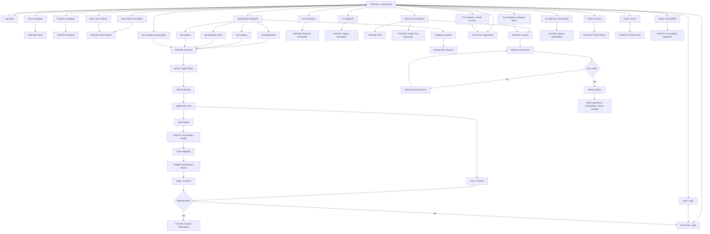
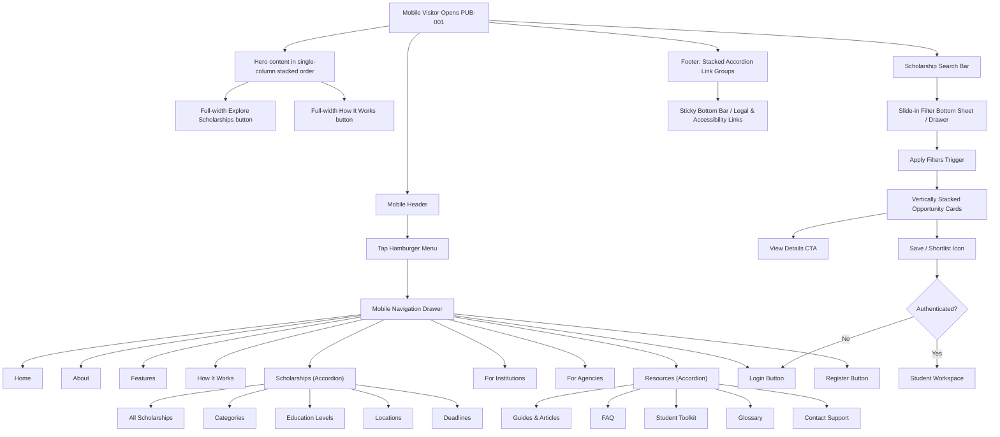

# CertiScholar: Master Product Design Specification & Screen Inventory

**Author:** Sekh Sujon Haque — Project Proponent & Originator  
**Institution:** Lovely Professional University (LPU), Punjab, India  
**Governance Lineage:** CS-SRS-002 v3.2 (M0–M20) | DOC-001 (Business Case) | DOC-002 (Charter) | DOC-003 (Process Flows) | DOC-004 (Wireframes)  
**Total Design Scope:** **16 Distinct Portals/Modules | 135 Screen Templates**

---

## Master Architecture & Module Index

```mermaid
flowchart TD
    M01["01 — Public Website (12 screens)"] --> M02["02 — Auth & Identity (7 screens)"]
    M02 --> M03["03 — Student Institutional Portal (15 screens)"]
    M02 --> M04["04 — Student Scholarship Network & Passport (12 screens)"]
    M02 --> M05["05 — Reviewer & Verification (9 screens)"]
    M02 --> M06["06 — Scholarship Officer (10 screens)"]
    M02 --> M07["07 — Committee Workspace (6 screens)"]
    M02 --> M08["08 — Institution Administration (10 screens)"]
    M02 --> M09["09 — Policy Intelligence (8 screens)"]
    M02 --> M10["10 — Source Governance & Connectors (9 screens)"]
    M02 --> M11["11 — Agency Portal (8 screens)"]
    M02 --> M12["12 — Marketplace Moderation (7 screens)"]
    M02 --> M13["13 — Partner Integration (6 screens)"]
    M02 --> M14["14 — Audit & Reporting (5 screens)"]
    M02 --> M15["15 — Support & Accessibility (4 screens)"]
    M02 --> M16["16 — Platform Operations & Security (7 screens)"]
```

---

# Detailed Screen-by-Screen Specifications (01 to 16)

---

## 01 — Public Website (12 Screen Templates & Master Interaction Map)
*Primary Persona:* Prospective Students, Parents, Partner Agencies, General Public  
*Purpose:* Institutional credibility, public scheme discovery, digital equity transparency, and onboarding gateway.

### A. Master Landing Page Architecture (PUB-001)

```mermaid
flowchart TD
    HOME["PUB-001 — PUBLIC HOME PAGE"]

    HOME --> HEADER["01 — GLOBAL HEADER"]
    HOME --> HERO["02 — HERO SECTION"]
    HOME --> TRUST["03 — TRUST & VALUE PROPOSITION"]
    HOME --> WORKS["04 — HOW IT WORKS"]
    HOME --> CAP["05 — PLATFORM CAPABILITIES"]
    HOME --> SCH["06 — FEATURED SCHOLARSHIPS"]
    HOME --> AUD["07 — WHO USES CERTISCHOLAR"]
    HOME --> TRANSPARENCY["08 — TRUST & TRANSPARENCY"]
    HOME --> FAQ["09 — FAQ PREVIEW"]
    HOME --> FINALCTA["10 — FINAL CALL TO ACTION"]
    HOME --> FOOTER["11 — GLOBAL FOOTER"]

    subgraph H["01 HEADER ELEMENTS"]
       TOP["Utility Bar"]
       LOGO["Logo + Product Name"]
       MENU["Main Navigation"]
       USER["Login / Register"]
       ACCESS["Accessibility Controls"]
       TOP --> TOPMAIL["Support Email Link (support@certischolar.org)"]
       TOP --> TOPPHONE["Telephone Link (+1 555 123-4567)"]
       TOP --> LANG["Language Selector (EN / HI / PA)"]
       TOP --> ACCESS["Accessibility (A+ A A-)"]
       MENU --> HOMEITEM["Home"]
       MENU --> ABOUT["About"]
       MENU --> FEATURES["Features"]
       MENU --> HOW["How It Works"]
       MENU --> SCHOLARSHIPS["Scholarships Dropdown"]
       MENU --> INSTITUTIONS["For Institutions"]
       MENU --> AGENCIES["For Agencies"]
       MENU --> RESOURCES["Resources Dropdown"]
       SCHOLARSHIPS --> ALL["All Scholarships"]
       SCHOLARSHIPS --> CATEGORY["Browse by Category"]
       SCHOLARSHIPS --> LEVEL["Browse by Education Level"]
       SCHOLARSHIPS --> LOCATION["Browse by Location"]
       SCHOLARSHIPS --> DEADLINE["Deadline Calendar"]
       RESOURCES --> GUIDES["Guides & Articles"]
       RESOURCES --> FAQPAGE["FAQ"]
       RESOURCES --> TOOLKIT["Student Toolkit"]
       RESOURCES --> GLOSSARY["Glossary"]
       USER --> LOGIN["Login"]
       USER --> REGISTER["Register"]
    end

    HEADER --> H

    subgraph HR["02 HERO"]
       EYEBROW["Eyebrow: EMPOWERING EDUCATION. ENRICHING FUTURES"]
       HEADLINE["Headline: Discover. Prepare. Apply. Track Scholarships with Confidence."]
       DESC["Description: CertiScholar brings clarity and trust to scholarship discovery, application management and institutional verification."]
       VISUAL["Visual: Student with laptop, graduation cap, shield & verification card preview"]
       EXPLORE["Button: Explore Scholarships"]
       HOWCTA["Button: How It Works"]
       LOGINCTA["Link: Already have an account? Login ->"]
    end
    HERO --> HR

    subgraph TR["03 TRUST AND STATS"]
       S1["50,000+ Scholarships"]
       S2["2,500+ Trusted Sources"]
       S3["1.2M+ Students Empowered"]
       S4["98% Information Accuracy*"]
    end
    TRUST --> TR

    subgraph WR["04 HOW IT WORKS (4 STEPS)"]
       W1["1. Discover: Find verified scholarships matching your profile"]
       W2["2. Prepare: Check eligibility, gather documents with guidance"]
       W3["3. Submit: Apply directly or hand over to institution seamlessly"]
       W4["4. Track: Track application status and receive important updates"]
       W1 --> W2 --> W3 --> W4
    end
    WORKS --> WR

    subgraph SR["06 FEATURED SCHOLARSHIPS"]
       SEARCH["Keyword Search field"]
       CATFILTER["Category dropdown"]
       EDUFILTER["Education level dropdown"]
       LOCFILTER["Location dropdown"]
       DATEFILTER["Deadline filter"]
       SEARCHBTN["Search button"]
       CLEARBTN["Clear filters button"]
       RESULT["Filtered Opportunity Cards"]
       CARD1["Global Excellence Scholarship 2025 (Undergrad, Int'l)"]
       CARD2["Tech Innovators Grant (Masters, STEM)"]
       CARD3["Women in Leadership Scholarship (Undergrad, Female)"]
       SEARCHBTN --> RESULT
       RESULT --> CARD1 & CARD2 & CARD3
    end
    SCH --> SR

    subgraph FR["11 GLOBAL FOOTER"]
       FBRAND["CertiScholar Brand & Social Links"]
       FQUICK["Quick Links"]
       FSTUDENT["For Students"]
       FINST["For Institutions"]
       FRESOURCES["Resources"]
       FCONTACT["Contact Info"]
       FLEGAL["Privacy Policy | Terms of Use | Accessibility Statement"]
    end
    FOOTER --> FR
```

### B. Complete Navigation & Interactive Destination Map

### C. Mobile Responsive Behavior (< 768px)

### D. Detailed Public Screen Inventory Table (PUB-001 to PUB-014)

| Screen ID | Screen Title | Purpose & Visual Architecture | Key Components & State | Lineage |
| :--- | :--- | :--- | :--- | :--- |
| **PUB-001** | **Public Landing Page** | Master entrypoint featuring 11 sections: Global Header, Hero, Trust Stats, 4-Step How It Works, Capabilities, Featured Scholarships (Search & Filter), Audiences, Transparency, FAQ Preview, Final CTA, and Footer. | Hero Banner, Live Stats Grid, 4-Step Stepper, Filterable Opportunity Cards, Trust Logos, Global Header & Footer. | Wireframe A |
| **PUB-002** | **About CertiScholar** | Mission, origin story, academic foundation (LPU Capstone P12), trust principles, explainable AI ethos. | Narrative Typography, Architecture Diagram Cards, Core Values Grid. | DOC-001 §1 |
| **PUB-003** | **Platform Capabilities** | In-depth breakdown of OCR document intelligence, rule engine, student passport, and committee governance. | Feature Grid, Bounding Box Animation, Comparison Table. | SRS M1–M10 |
| **PUB-004** | **How It Works** | Comprehensive interactive 4-step workflow explainer: Discover $\to$ Prepare $\to$ Submit $\to$ Track, with detailed stage cards and video walkthrough. | Interactive Step Switcher, Video Demo Embed, Process Flowchart. | DOC-003 §8 |
| **PUB-005** | **Scholarship Directory** | Filterable public catalog of open scholarships with search by education level, category, location, and deadline calendar. | Multi-facet Filter Sidebar, Opportunity Cards, Pagination, Sort Dropdown. | SRS M15 |
| **PUB-006** | **For Institutions** | Enterprise pitch for university administrators, SIS/ERP integration highlights, and compliance standards (DPDP 2023). | University Partner Logos, Security Badges, "Request Demo" Form. | DOC-002 |
| **PUB-007** | **For Agencies** | Dedicated landing for CSR trusts and private donors to register as listing publishers. | Value Proposition Cards, Agency Verification Checklist, "Get Started" CTA $\to$ `AGY-001`. | SRS M14 |
| **PUB-008** | **Frequently Asked Questions (FAQ)** | Accordion-style categorized FAQs covering data privacy, eligibility recomputations, appeals, and review times. | Categorized Accordion, Live Search, "Still Have Questions?" Contact Card. | General |
| **PUB-009** | **Resources & Guides** | Guides on certificate issuance (DigiLocker, Tehsildar income certs, caste verification), student toolkit, glossary. | Searchable Knowledge Base, Downloadable PDF Guides, Student Toolkit. | SRS M20 |
| **PUB-010** | **Contact & Support** | Contact form, campus office locations (LPU Student Welfare Wing), support email directory, ticket creation flow. | Interactive Map Embed, Form with Inline Validation, Office Hour Badges $\to$ Ticket Created. | PRC-13 |
| **PUB-011** | **Scholarship Details & Pre-checker** | Complete eligibility breakdown, deadline countdown, award value, required documents, and interactive eligibility pre-check. | Sticky CTA Header, Deadline Chip, Eligibility Checklist, Pre-checker Modal $\to$ `AUTH-001` / `STU-001`. | SCR-003 |
| **PUB-012** | **Privacy Policy** | Comprehensive DPDP Act 2023 compliance disclosure, data retention schedule, cookie/consent policy. | Structured Legal Document Typography, Version Date Stamp, Print Button. | SRS §12 |
| **PUB-013** | **Terms of Use** | Platform usage terms, credential protection, anti-scraping rules, liability bounds. | Structured Legal Document Typography, Version Date Stamp. | Standard Terms |
| **PUB-014** | **Accessibility Statement** | Formal WCAG 2.2 AA accessibility commitment, screen reader compatibility, and feedback contact. | Accessible Contrast Matrix, Multi-language Support Statement (EN/HI/PA). | M20 / WCAG |

---

## 02 — Authentication & Identity (7 Screen Templates)
*Primary Persona:* All Users (Students, Reviewers, Committee, Admins, Agency Publishers)  
*Purpose:* Secure, role-gated authentication, multi-tenancy routing, and DPDP-compliant consent capture.

| Screen ID | Screen Title | Purpose & Visual Architecture | Key Components & State | Lineage |
| :--- | :--- | :--- | :--- | :--- |
| **SCR-AUTH-01** | **Unified Login Screen** | Email/Registration number and password input, institutional SSO (Google/OIDC) button, role badge indicators. | Split Layout (Branded Artwork Left, Form Right), Password Masking, "Remember Me". | SRS M0 |
| **SCR-AUTH-02** | **Student Account Registration** | Account creation wizard capturing name, university roll number, email, phone, and privacy consent checkboxes. | Step Indicator, Password Strength Meter, Mandatory DPDP Consent Checkbox. | FR-0.1 |
| **SCR-AUTH-03** | **Tenant / Institution Selector** | Multi-institution routing screen allowing users to pick their affiliated university (default: LPU). | Institution Search Bar, University Logo Cards, Subdomain Auto-routing. | FR-0.3 |
| **SCR-AUTH-04** | **OTP Verification Screen** | 6-digit numeric input with auto-focus and resend countdown timer for email and phone verification. | 6-Box Pin Input, Resend Timer (60s), Error Shake Animation. | FR-0.1 |
| **SCR-AUTH-05** | **Multi-Factor Authentication (MFA)** | TOTP authenticator app QR code setup or secondary code entry for administrative and reviewer roles. | QR Code Display, Backup Recovery Codes Modal, Verify Button. | SRS §12 |
| **SCR-AUTH-06** | **Password Recovery & Reset** | "Forgot Password" request form, email dispatch confirmation, and new password definition form. | Email Input, Status Alert Banner, Secure Token Reset Handler. | Standard Auth |
| **SCR-AUTH-07** | **Role Switcher & Session Hub** | Floating or top-bar control allowing authorized staff to switch contexts between Reviewer, Officer, and Committee. | Avatar Dropdown, Active Role Pill, Tenant Identifier, Sign Out Button. | DOC-004 §5.2 |

---

## 03 — Student Institutional Portal (15 Screen Templates)
*Primary Persona:* Enrolled University Students  
*Purpose:* Institutional scholarship discovery, wizard-driven application submission, document management, and live milestone tracking.

| Screen ID | Screen Title | Purpose & Visual Architecture | Key Components & State | Lineage |
| :--- | :--- | :--- | :--- | :--- |
| **SCR-STU-01** | **Student Main Dashboard** | Command center: Active applications, pending actions, document health alerts, deadline calendar. | Application Cards, Milestone Progress Bar, Alert Callouts, Quick Action CTA. | SCR-001 |
| **SCR-STU-02** | **Student Profile & Academics** | Personal information, program details, verified CGPA/marks record, domicile/category certificates on file. | Editable Section Cards, Verified Field Badges, Document History Links. | JRN-01 |
| **SCR-STU-03** | **Institutional Scheme Catalog** | University-funded scholarship schemes (e.g. Need-Based Aid, Shikshak Samman, Sports Merit). | Scheme Cards, Benefit Percentage Pills, "Check Eligibility" Trigger. | PRC-02 |
| **SCR-STU-04** | **Eligibility Pre-check** | Instant self-assessment calculator: enter expected marks and income to get real-time eligibility feedback. | Range Sliders, Dynamic Eligibility Indicator ("Likely Eligible"), Apply Now CTA. | M8 / M9 |
| **SCR-STU-05** | **Wizard Step 1: Scheme Selection** | Selecting target scheme, reviewing eligibility criteria, and agreeing to institutional declaration. | Scheme Selector Radio Cards, Declaration Checkbox, Next Step Trigger. | SCR-005 |
| **SCR-STU-06** | **Wizard Step 2: Academic Inputs** | Entering 10th/12th/Semester marks, roll numbers, board/university names with real-time format validation. | Form Grid, Marks Calculation Preview, Roll Number Helper Text. | SCR-005 |
| **SCR-STU-07** | **Wizard Step 3: Financial & Category** | Annual family income, Tehsil/issuing authority, certificate serial number, caste/disability selection. | Income Input with Currency Mask, Issuing Authority Dropdown, Date Picker. | SCR-005 |
| **SCR-STU-08** | **Document Center: Checklist** | Custom checklist generated based on scheme rules (e.g., Marksheet + Income Cert + Affidavit). | Required vs Optional Document Badges, Format Guidance Notice. | SCR-006 |
| **SCR-STU-09** | **Document Upload & Dropzone** | Drag-and-drop zone with instant client-side PDF validation, size check (<10MB), and scan quality meter. | Dropzone Area, Upload Progress Bar, File Preview Thumbnail, Delete Button. | SCR-006 |
| **SCR-STU-10** | **Application Tracking Timeline** | Visual vertical stepper showing exact stage: Intake $\to$ Clean $\to$ OCR Processing $\to$ Review $\to$ Decision. | Animated Stepper, Timestamp Logs, Officer Notes (if public), SLA Indicator. | SCR-007 |
| **SCR-STU-11** | **Application Case Detail View** | Read-only summary of submitted application, attached documents, and system-calculated percentage. | Tabbed Detail View (Form Data, Documents, Audit Trail), Download Summary PDF. | SCR-010 |
| **SCR-STU-12** | **Document Re-upload / Correction** | Dedicated view triggered when an officer requests a clearer scan; highlights the exact rejected file. | Reason Callout Box ("Blurry seal"), Target File Dropzone, Submit Replacement. | EX-004 |
| **SCR-STU-13** | **Award Offer & Acceptance** | Formal award notification, fee waiver percentage, terms of scholarship, and digital "Accept Offer" button. | Congratulations Hero Card, Benefit Breakdown Table, Accept/Decline Actions. | SCR-022 |
| **SCR-STU-14** | **Disbursement & Renewal Tracker** | Academic term fee adjustment record, renewal requirements (minimum CGPA needed for next semester). | Term History Table, Renewal Threshold Meter, Renewal Checklist. | M18 |
| **SCR-STU-15** | **Institutional Appeal & Grievance** | Grievance lodgement form for rejected applicants to submit supplementary evidence or dispute recomputations. | Rejection Reason Reference, Evidence File Upload, Statement Textarea, Submit. | SCR-023 |

---

## 04 — Student Scholarship Network & Passport (12 Screen Templates)
*Primary Persona:* Students seeking state, national, and private external scholarships  
*Purpose:* Cross-portal opportunity discovery, matching, private credential vault, and consented external handoff.

| Screen ID | Screen Title | Purpose & Visual Architecture | Key Components & State | Lineage |
| :--- | :--- | :--- | :--- | :--- |
| **SCR-NET-01** | **External Marketplace Explorer** | National/State scholarship directory (NSP, state schemes, private CSR funds) with keyword search. | Multi-tier Filter Sidebar, Scheme List Cards, Freshness Badges, Match Score. | SCR-002 |
| **SCR-NET-02** | **Opportunity Detail & Match** | Detailed scheme terms with explainable matching panel showing exactly which criteria the student meets/misses. | Explainable Match Bar, Provenance Source Badge ("Official NSP"), Deadline Pill. | SCR-003 |
| **SCR-NET-03** | **Scholarship Comparison Matrix** | Side-by-side comparison of 2–3 selected scholarships (award amount, criteria, bond conditions). | 3-Column Comparison Table, Highlight Difference Toggle, Apply Buttons. | SCR-004 |
| **SCR-NET-04** | **Student Shortlist & Calendar** | Bookmarked external opportunities with deadline calendar integration and email reminder triggers. | Calendar Grid View, Kanban Shortlist Column, Deadline Alert Toggles. | M15 |
| **SCR-NET-05** | **Student Digital Passport** | Reusable verified student credentials profile (verified marks, income tier, domicile) ready for external export. | Digital Passport Card, Verified QR Code, Attribute Verification Badges. | SCR-019 |
| **SCR-NET-06** | **Private Document Vault** | Encrypted repository of student documents available for one-click attachment to partner applications. | File Grid, Encryption State Pill ("AES-256"), Download / Share Action Menus. | M16 |
| **SCR-NET-07** | **Granular Consent Modal** | User specifies exact recipient, allowed fields (e.g. share marks but hide Aadhaar), and expiration date (e.g. 7 days). | Field Checkbox Matrix, Recipient Warning Card, Expiry Selector, Confirm Button. | SCR-020 |
| **SCR-NET-08** | **External Portal Handoff Screen** | Pre-handoff interstitial explaining the user is exiting to an external government portal; copies needed data to clipboard. | Departure Notice Card, Data Clipboard Assist Drawer, "Continue to NSP" Link. | BR-020 |
| **SCR-NET-09** | **Partner Direct Application Flow** | In-app application submission for accredited partner agencies using API integration contracts. | Partner Branded Form, Pre-filled Passport Data, Final Review Step. | M16 / M19 |
| **SCR-NET-10** | **External Submission Tracker** | Tracking dashboard recording submissions made to external agencies with application references. | External Case Table, Partner Status Poll Pill, External Receipt Downloader. | PRC-10 |
| **SCR-NET-11** | **Consent Audit & Access History** | Immutable log of every third-party entity that accessed the student's passport data, with revocation buttons. | Access Event Log, Recipient Name, Data Fields Disclosed, "Revoke Grant" Action. | BR-018 |
| **SCR-NET-12** | **Opportunity Notification Settings** | User preferences for automated scholarship alerts (matching schemes, impending deadlines, SMS/WhatsApp). | Notification Channel Toggles, Minimum Match Threshold Slider (e.g. >80%). | M11 |

---

## 05 — Reviewer & Verification (9 Screen Templates)
*Primary Persona:* Document Verification Officers / Reviewers  
*Purpose:* Inspecting OCR extraction results, correcting bounding boxes, verifying official credentials, and resolving discrepancies.

| Screen ID | Screen Title | Purpose & Visual Architecture | Key Components & State | Lineage |
| :--- | :--- | :--- | :--- | :--- |
| **SCR-REV-01** | **Assigned Reviewer Queue** | Worklist of assigned student cases prioritized by submission timestamp and SLA countdown timer. | Queue Table, Case Priority Badges, SLA Timer, Filter by Scheme / Status. | SCR-009 |
| **SCR-REV-02** | **Priority Anomaly Queue** | Filtered queue highlighting applications where the system detected arithmetic mismatches or low OCR confidence (<85%). | Anomaly Type Tag ("Marks Mismatch", "Blurry Scan"), Risk Score Indicator. | M5 / M6 |
| **SCR-REV-03** | **Split-Screen Reviewer Workspace** | **The Core Showstopper Screen:** Left pane renders multi-page PDF document; Right pane displays extracted fields. | Dual-Pane Resizable Layout, Zoom/Rotate Toolbar, Page Thumbnail Drawer. | SCR-008 |
| **SCR-REV-04** | **Interactive Bounding Box Canvas** | Interactive document viewer highlighting text regions in colored bounding boxes (Green=High, Amber=Low, Red=Mismatch). | Canvas Overlay, Highlight Tooltip, Click-to-Focus Sync between Doc & Form. | M2–M4 |
| **SCR-REV-05** | **Field Correction & Override Form** | Form pane showing extracted vs claimed values, confidence scores, and editable override inputs with mandatory reason. | Editable Input Fields, Confidence Chips (%), "Correct Value" Modal, Reason Text. | FR-5.1 |
| **SCR-REV-06** | **Official Verification Lookup** | Secondary drawer to query official verification sources (e.g. DigiLocker, state board API) or record physical check. | API Match Status Badge, External Response JSON Viewer, Manual Verification Note. | M7 |
| **SCR-REV-07** | **Discrepancy / Re-upload Modal** | Dialog allowing the reviewer to reject a specific document with pre-set reason codes (e.g. illegible, expired, forged). | Reason Code Radio Group, Custom Note Textarea, "Request Re-upload" Action. | EX-004 |
| **SCR-REV-08** | **Case Review History & Audit** | Audit timeline showing previous reviewer actions, past corrections, and system extraction logs. | Chronological Timeline, Actor Badge, Before/After Value Comparison Table. | M10 |
| **SCR-REV-09** | **Batch Review & Handoff Summary** | Batch summary allowing an officer to sign off multiple clean verified applications and route them to Committee. | Selected Case Checklist, Batch Verification Stats, "Submit to Committee" CTA. | PRC-03 |

---

## 06 — Scholarship Officer (10 Screen Templates)
*Primary Persona:* Scholarship / Financial Aid Officers  
*Purpose:* Operational oversight, workload management, scheme criteria management, eligibility evaluation, and committee pack routing.

| Screen ID | Screen Title | Purpose & Visual Architecture | Key Components & State | Lineage |
| :--- | :--- | :--- | :--- | :--- |
| **SCR-OFF-01** | **Master Operational Queue** | Comprehensive view of all departmental applications across all statuses with batch assignment tools. | Filter Bar (Cycle, Department, Status), Staff Reassignment Dropdown, Bulk Actions. | JRN-03 |
| **SCR-OFF-02** | **Scheme Cycle Management** | Dashboard managing active, upcoming, and closed scholarship cycles; sets application windows and seat quotas. | Cycle Cards, Date Range Editor, Active Status Toggle, Seat Quota Editor. | PRC-01 |
| **SCR-OFF-03** | **Document Checklist Config** | Configuring mandatory and optional document requirements per scheme (e.g., Marksheet + EWS Income Certificate). | Drag-and-Drop Document Checklist Builder, Format Restrictor, Profile Binder. | M8 |
| **SCR-OFF-04** | **Workload Allocation Console** | Distributing incoming application queues evenly among verification officers based on capacity. | Reviewer Capacity Progress Bars, Auto-assign Balancing Toggle, Reassign Modal. | JRN-03 |
| **SCR-OFF-05** | **Eligibility Engine Batch Run** | Triggering and monitoring automated rule engine evaluation runs across batches of verified applications. | "Run Engine" Trigger, Batch Progress Meter, Evaluated vs Flagged Stats. | M8 / M9 |
| **SCR-OFF-06** | **Recommendations Evaluation** | Reviewing system-generated recommendations (`ELIGIBLE`, `NOT_ELIGIBLE`, `QUOTA_EXCEEDED`) before committee handoff. | Recommendation Table, Score Breakdown Drawer, Officer Concurrence Toggle. | SCR-010 |
| **SCR-OFF-07** | **Committee Pack Assembly** | Curating candidate dossiers into formal meeting agenda packs for the upcoming Scholarship Committee review. | Candidate Multi-select, Agenda Grouping Tool, "Export Committee Dossier" Button. | JRN-04 |
| **SCR-OFF-08** | **Decision Dispatch Center** | Bulk dispatching approval and rejection notifications to students once committee decisions are signed off. | Email/SMS Preview Cards, Template Selector, Send Batch Dispatches Button. | M11 |
| **SCR-OFF-09** | **Scheme Budget & Benefit Tracker** | Monitoring real-time allocated scholarship funds against the university budget pool (e.g. ₹10 Crore allocated vs budget). | Budget Utilization Meter, Scheme Spend Breakdown Charts, Remaining Seat Counter. | DOC-001 §11 |
| **SCR-OFF-10** | **Operational SLA Dashboard** | Analytics monitoring average handling times, review bottlenecks, document rejection rates, and queue aging. | SLA Aging Heatmap, Average Handling Time Bar Chart, Reviewer Performance Grid. | PRC-16 |

---

## 07 — Committee Workspace (6 Screen Templates)
*Primary Persona:* Scholarship Committee Members, Deans, Committee Chair  
*Purpose:* Formal governance, quorum management, conflict of interest declarations, candidate ranking, and award sign-off.

| Screen ID | Screen Title | Purpose & Visual Architecture | Key Components & State | Lineage |
| :--- | :--- | :--- | :--- | :--- |
| **SCR-COM-01** | **Committee Meeting Agenda** | Scheduled review sessions, active committee quorum attendees, agenda list of candidate batches. | Meeting Details Card, Quorum Status Pill (e.g., 3/5 Present), Start Session CTA. | JRN-04 |
| **SCR-COM-02** | **Case Pack Dossier** | Comprehensive candidate view: academic scores, verified income, verification notes, and explainable rule outputs. | Side-by-Side Summary Dossier, Document Quick View Modal, Verification Badge. | SCR-011 |
| **SCR-COM-03** | **Candidate Ranking Matrix** | Merit vs Need composite score ranking table allowing committee to evaluate cutoff thresholds against seat quotas. | Sortable Ranking Table, Cutoff Threshold Line, Quota Fill Indicator. | M9 |
| **SCR-COM-04** | **Conflict of Interest Declaration** | Mandatory disclosure screen where committee members must declare relationships to applicants before voting. | Applicant Names List, Conflict Checkbox, Reason Text, Signature Confirmation. | BR-010 |
| **SCR-COM-05** | **Quorum Voting Console** | Deliberation console where each member casts formal votes: `AWARD`, `REJECT`, `DEFER`, or `OVERRIDE`. | Member Vote Pills, Quorum Consensus Bar, Reason for Override Textbox. | SCR-011 |
| **SCR-COM-06** | **Formal Sign-Off & Minuting** | Digital signature and resolution generation recording the committee's final legally binding scholarship decisions. | Meeting Minutes Preview, Digital Signature Pad / Token Confirm, Seal Decision. | M10 |

---

## 08 — Institution Administration (10 Screen Templates)
*Primary Persona:* University System Administrator, Registrar's Office  
*Purpose:* Multi-tenancy configuration, university branding, user role management, system integrations, and compliance settings.

| Screen ID | Screen Title | Purpose & Visual Architecture | Key Components & State | Lineage |
| :--- | :--- | :--- | :--- | :--- |
| **SCR-ADM-01** | **Tenant Settings & Branding** | Institution name, university emblem/logo upload, theme primary/secondary color picker, official circular header. | Logo Upload Dropzone, Color Token Pickers, Live Preview Header Card. | FR-0.3 |
| **SCR-ADM-02** | **User Directory & RBAC** | Managing staff accounts, assigning roles (`REVIEWER`, `OFFICER`, `COMMITTEE`), revoking access. | Searchable Staff Table, Role Multi-select Modal, Status Toggle (Active/Suspended). | FR-0.2 |
| **SCR-ADM-03** | **Faculty & Department Config** | University hierarchy tree (Schools, Departments, Programmes, Batches) for scoped eligibility rules. | Interactive Tree View, Add Department Modal, Program Code Editor. | M0 |
| **SCR-ADM-04** | **Academic Year Planner** | Setting institutional terms, semester boundaries, admission cycle start/end dates. | Term List Table, Date Range Pickers, Active Academic Cycle Selector. | PRC-01 |
| **SCR-ADM-05** | **Scheme Architecture Manager** | Master catalog of institutional schemes, allocating departmental quotas and funding categories (EWS, Sports, etc.). | Scheme Master Grid, Category Filter Tabs, Quota Allocation Modal. | M8 |
| **SCR-ADM-06** | **Extraction Profile Builder** | Binding expected document types (e.g. Punjab State Income Cert) to specific regex and field extraction rules. | Profile List, Field Schema Builder, Sample Test Runner. | M3 / M4 |
| **SCR-ADM-07** | **SIS / ERP Integration Sync** | Connecting CertiScholar to LPU's ERP via API or database connectors; configuring sync frequency and mappings. | Connection Status Pill, API Endpoint Input, Field Mapping Drawer, Test Ping CTA. | Section 6 |
| **SCR-ADM-08** | **Notification Templates** | Rich-text email and SMS template editor with dynamic variable tags (e.g. `{{student_name}}`, `{{scheme_title}}`). | Template Editor, Variable Chip Selector, Email Preview Pane. | M11 |
| **SCR-ADM-09** | **Configuration Audit History** | Immutable change log tracking every administrative setting modification, author, and timestamp. | Audit Table, Before/After Diff Viewer, Filter by Admin User. | M10 |
| **SCR-ADM-10** | **Data Retention & Privacy** | Setting automated data purging rules for old applications, personal document anonymization schedules. | Retention Period Dropdowns (e.g., 3 Years), Anonymize On/Off Toggle, Purge Log. | SRS §12 |

---

## 09 — Policy Intelligence (8 Screen Templates)
*Primary Persona:* Scholarship Policy Owners, Legal Counsel  
*Purpose:* Ingesting official circulars, extracting rule assertions via AI assistance, visual rule editing, simulation, and dual-control approvals.

| Screen ID | Screen Title | Purpose & Visual Architecture | Key Components & State | Lineage |
| :--- | :--- | :--- | :--- | :--- |
| **SCR-POL-01** | **Policy Circular Capture** | Uploading new university or government scholarship gazette circulars (PDF format). | PDF Upload Zone, Issuing Body Dropdown, Effective Date Picker. | SCR-021 |
| **SCR-POL-02** | **Circular Annotation View** | Text-selectable view of the circular PDF allowing policy owners to highlight key eligibility clauses. | PDF Text Viewer, Text Highlight Tool, Clause Tagging Drawer. | M17 |
| **SCR-POL-03** | **AI Clause Inspector** | Reviewing system-suggested eligibility assertions extracted from circular text (e.g. "Family income < 2.5 LPA"). | Extracted Assertion Cards, Confidence Pill, "Accept into Rule" Checkbox. | M17 |
| **SCR-POL-04** | **Visual Rule Builder Studio** | Drag-and-drop boolean logic tree builder (`AND`, `OR`, `NOT`, Threshold comparisons) for scheme rules. | Visual Node Graph / Tree, Operand Selector, Threshold Input Fields. | SCR-013 |
| **SCR-POL-05** | **Test Fixtures Library** | Catalog of historical/synthetic student profile test cases used to validate whether a new rule behaves as expected. | Fixture Cards, Profile Attribute Summary, "Run Test" Trigger. | M17 |
| **SCR-POL-06** | **Simulation & Replay Console** | Simulating the new rule against last year's student dataset to preview budgetary and qualification impact. | Qualification Impact Chart, Budget Variance Graph, Excluded Applicant Table. | M17 |
| **SCR-POL-07** | **Dual-Control Approval** | Mandatory two-person rule sign-off where an independent policy authority must approve the rule draft. | Rule Diff Comparison View, Secondary Reviewer Signature Pad, Approve Button. | ADR-013 |
| **SCR-POL-08** | **Policy Version History** | Complete historical version tree showing how scheme rules evolved over years with superseded dates. | Version Timeline Stepper, View Historic Ruleset Button, Corrigendum Notes. | M8 |

---

## 10 — Source Governance & Connectors (9 Screen Templates)
*Primary Persona:* Data Integration Engineers, Platform Administrators  
*Purpose:* External scholarship source registration, terms of use review, connector scheduling, and data health monitoring.

| Screen ID | Screen Title | Purpose & Visual Architecture | Key Components & State | Lineage |
| :--- | :--- | :--- | :--- | :--- |
| **SCR-SRC-01** | **Source Registry Catalog** | Directory of external feeds (NSP, state government portals, private CSR feeds) with trust ratings. | Source Grid, Trust Tier Badge ("Official Govt", "Verified NGO"), Health Status. | M13 |
| **SCR-SRC-02** | **Source Onboarding Wizard** | Step-by-step registration of a new external opportunity provider and source domain. | URL Input, Source Type Selector, Publisher Entity Information Form. | PRC-07 |
| **SCR-SRC-03** | **Terms & Legal Basis Review** | Mandatory legal check certifying that crawling/API access is permitted under terms of service and robots.txt. | Terms Review Checklist, Legal Clearance Document Upload, Sign-off Checkbox. | SRS §6.4 |
| **SCR-SRC-04** | **Connector Config Studio** | Technical connector configuration: REST API headers, RSS feed endpoint, or approved HTML parser selector. | Request Header Key-Value Editor, Polling Interval Dropdown, Auth Token Vault. | M13 |
| **SCR-SRC-05** | **Ingestion Job Scheduler** | Automated cron schedule manager controlling when each external source is crawled/ingested. | Cron Schedule Table, "Trigger Manual Ingestion" CTA, Execution History. | PRC-07 |
| **SCR-SRC-06** | **Snapshot Archive Viewer** | Immutable snapshot repository showing the exact raw JSON or HTML page captured during an ingestion run. | Versioned Snapshot List, Raw Payload Diff Viewer, Hash Integrity Check. | M13 |
| **SCR-SRC-07** | **Canonical Schema Mapper** | Visual field mapper matching source-specific fields to the CertiScholar Canonical Data Model (Appendix Q). | Two-Column Field Linking Canvas, Transformation Rule Editor (e.g. Date format). | Appx Q |
| **SCR-SRC-08** | **Data Freshness Monitor** | Tracking stale external opportunities (e.g. listings that haven't updated in 30 days or broken deadlines). | Freshness Aging Meter, Expired Opportunity Table, Automated Archive Toggle. | BR-015 |
| **SCR-SRC-09** | **Source Health & Alerts** | Real-time monitoring of connector failure rates, HTTP 403/500 errors, and broken endpoint alerts. | Uptime Percentage Charts, Error Log Table, Notification Dispatch Settings. | M13 |

---

## 11 — Agency Portal (8 Screen Templates)
*Primary Persona:* External Scholarship Publishers (NGOs, Corporate CSR Trusts, Philanthropists)  
*Purpose:* Agency organization KYC, listing authoring, evidence submission, and applicant pipeline tracking.

| Screen ID | Screen Title | Purpose & Visual Architecture | Key Components & State | Lineage |
| :--- | :--- | :--- | :--- | :--- |
| **SCR-AGN-01** | **Agency Onboarding Wizard** | Organization registration capturing trust registration numbers, PAN/tax details, and representative info. | Multi-step Company Form, Tax Registration Upload, Domain Verification Step. | SCR-016 |
| **SCR-AGN-02** | **Representative KYC Review** | Identity proof submission of the nominated publishing officer to prevent fake scholarship listings. | ID Document Upload, Authorization Letter from Board of Trustees, Status Pill. | M14 |
| **SCR-AGN-03** | **Agency Team Management** | Adding sub-users within the agency (e.g. Content Writer, Financial Officer, Admin). | Team Member Grid, Role Assignment Modal, Pending Invitations List. | M14 |
| **SCR-AGN-04** | **Scholarship Listing Studio** | Rich-text editor for publishing new scholarship opportunities: title, total corpus, eligibility, deadlines. | Form Studio, Rich-text Description Editor, Award Tier Configurator. | SCR-017 |
| **SCR-AGN-05** | **Eligibility Criteria Builder** | Specifying academic cutoffs, parental income limits, and geographic criteria for the agency's scheme. | Criterion Rule Selectors, Required Document Toggles, Minimum Score Sliders. | SCR-017 |
| **SCR-AGN-06** | **Authority Evidence Upload** | Attaching official circulars, trust deed excerpts, or corporate CSR approval documents supporting the listing. | Evidence Document Dropzone, Legal Declaration Checkbox, Preview Listing Button. | BR-012 |
| **SCR-AGN-07** | **Listing Moderation Tracker** | Real-time status tracker for submitted listings (`PENDING_REVIEW`, `APPROVED`, `MODIFICATIONS_REQUESTED`). | Listing Cards, Moderation Feedback Drawer, Resubmit Modification Button. | M14 |
| **SCR-AGN-08** | **Applicant Telemetry & Metrics** | Anonymized aggregate analytics showing student interest: views, passport handoffs, eligible candidate pools. | Funnel Bar Chart, Geographic Reach Map, Total Corpus Distributed Card. | M14 |

---

## 12 — Marketplace Moderation (7 Screen Templates)
*Primary Persona:* Marketplace Trust & Safety Moderators  
*Purpose:* Reviewing agency listings, validating authority evidence, investigating student complaints, and enforcing takedowns.

| Screen ID | Screen Title | Purpose & Visual Architecture | Key Components & State | Lineage |
| :--- | :--- | :--- | :--- | :--- |
| **SCR-MOD-01** | **Moderation Incoming Queue** | Worklist of newly submitted agency scholarship listings awaiting independent verification. | Queue Table, Agency Trust Score Pill, Submission Timestamp, Review CTA. | SCR-018 |
| **SCR-MOD-02** | **Listing Verification View** | Side-by-side view of the proposed listing details alongside the agency's uploaded legal authority evidence. | Split Screen (Listing Preview Left, Evidence Document Right), Checklist Toggles. | M14 |
| **SCR-MOD-03** | **Trust Badge Assignment** | Setting the verified trust status: `Official Govt Corroborated`, `Verified Trust`, or `Unverified Agency Declared`. | Trust Tier Radio Cards, Public Display Label Preview, Confirm Badge Button. | DOC-004 §14.2 |
| **SCR-MOD-04** | **Complaint & Fraud Inbox** | Central queue of student reports flagging scam listings, fee charging violations, or fake scholarships. | Complaint Ticket List, Severity Badges ("Critical - Fee Scam"), Evidence Files. | BR-011 |
| **SCR-MOD-05** | **Takedown & Rejection Workflow** | Immediate suspension modal to remove a fraudulent or non-compliant listing from the public marketplace. | Immediate Takedown Switch, Pre-formatted Legal Notice to Agency, Execute. | SCR-018 |
| **SCR-MOD-06** | **Publisher Appeal Center** | Reviewing appeals submitted by agencies whose listings were rejected or suspended. | Agency Appeal Statement, Revised Evidence Review, Re-evaluate Actions. | M14 |
| **SCR-MOD-07** | **Moderation Audit Trail** | Immutable log tracking all moderation decisions, assigned trust badges, and takedowns. | Audit Table, Moderator ID, Decision Rationale, Historical Replay Link. | M10 |

---

## 13 — Partner Integration (6 Screen Templates)
*Primary Persona:* University IT Integration Engineers, External Partner Developers  
*Purpose:* Managing API scopes, API keys, webhook monitoring, and sandbox conformance testing.

| Screen ID | Screen Title | Purpose & Visual Architecture | Key Components & State | Lineage |
| :--- | :--- | :--- | :--- | :--- |
| **SCR-PRT-01** | **Developer Portal & Docs** | Interactive OpenAPI / Swagger documentation explorer, code snippet generators (cURL, Python, JS). | OpenAPI Swagger UI Embed, Environment Switcher (Sandbox/Prod), Auth Guide. | contracts/openapi |
| **SCR-PRT-02** | **API Key & Scope Manager** | Generating and rotating scoped API keys (e.g. read-only student passport verification). | API Key Generator Modal, Scope Checkboxes (Read, Write, Webhook), Secret Reveal. | M19 |
| **SCR-PRT-03** | **Interactive Sandbox Console** | Testing API calls against mock student data to verify integrations before touching production. | Mock Request Builder, Sample Response JSON Viewer, Response Status Code Pill. | M19 |
| **SCR-PRT-04** | **Canonical Schema Validator** | Online JSON payload validator testing compliance against the Appendix Q Interoperability Contract. | JSON Code Editor with Syntax Highlighting, "Validate Schema" Trigger, Error Log. | Appx Q |
| **SCR-PRT-05** | **Webhook Endpoint Manager** | Registering destination URLs for event dispatch (e.g. `application.awarded`, `document.verified`). | Webhook URL Input, Secret HMAC Key Display, Event Subscription Checkboxes. | contracts/events |
| **SCR-PRT-06** | **Webhook Delivery Log** | Real-time log of outgoing webhook attempts, HTTP response codes, latency, and automated retry status. | Delivery Table, Retry Button, Request/Response Payload Inspector Modal. | Section 10 |

---

## 14 — Audit & Reporting (5 Screen Templates)
*Primary Persona:* Internal University Auditors, Regulatory Reviewers, Department Heads  
*Purpose:* Forensic case reconstruction, tamper-evident audit queries, and official statutory reporting.

| Screen ID | Screen Title | Purpose & Visual Architecture | Key Components & State | Lineage |
| :--- | :--- | :--- | :--- | :--- |
| **SCR-AUD-01** | **Audit Log Explorer** | Searchable append-only event store capturing every user login, document upload, field edit, and committee vote. | Multi-filter Search Bar, Event Type Badges, Actor Identifier, Timestamp. | SCR-024 |
| **SCR-AUD-02** | **Forensic Case Reconstruction** | Complete step-by-step timeline of a single application showing exact system states and human actions from Day 1. | Vertical Event Stepper, State Diff Viewer, Cryptographic Hash Chain Badge. | M10 |
| **SCR-AUD-03** | **Regulatory Compliance Reports** | Pre-formatted institutional reports (NAAC, NIRF, UGC financial aid audit summaries) exportable as PDF/Excel. | Report Template Selector, Academic Cycle Filter, Generate & Download Actions. | PRC-14 |
| **SCR-AUD-04** | **Controlled Data Exporter** | Export console with mandatory PII anonymization / pseudonymization options before downloading CSV data. | Field Selection Matrix, Anonymize PII Toggle (Mask Names/Aadhaar), Download. | M10 / §12 |
| **SCR-AUD-05** | **Data Erasure & Disposal History** | Permanent compliance certificate log verifying that student documents were safely purged according to retention limits. | Purge Job Certificates, Destruction Date, Authorized Officer Signature Record. | SRS §12 |

---

## 15 — Support & Accessibility (4 Screen Templates)
*Primary Persona:* Students needing technical help, Disabled Users, Support Staff  
*Purpose:* Helpdesk ticket management, digital equity accommodations, and multilingual localization.

| Screen ID | Screen Title | Purpose & Visual Architecture | Key Components & State | Lineage |
| :--- | :--- | :--- | :--- | :--- |
| **SCR-SUP-01** | **Support & Help Center** | Knowledge base with categorized troubleshooting guides, document upload tips, and ticket submission CTA. | Search Bar, Popular Articles Grid, "Submit a Ticket" Quick Action. | PRC-13 |
| **SCR-SUP-02** | **Support Ticket Workspace** | Two-way ticketing interface allowing students to chat with support staff regarding technical issues or bugs. | Ticket Thread View, Status Badge (`OPEN`, `RESOLVED`), File Attachment Button. | SCR-023 |
| **SCR-SUP-03** | **Digital Equity & Accessibility** | Preferences panel configuring WCAG 2.2 accommodations: High Contrast, Large Text, Screen Reader mode, Dyslexic font. | Accommodation Toggles, Contrast Radio Options, Text Size Range Slider. | M20 |
| **SCR-SUP-04** | **Multilingual Localization Hub** | Language selector allowing instant toggling of the entire UI and help materials between English, Hindi, and Punjabi. | Language Switcher Radio Cards (English, हिंदी, ਪੰਜਾਬੀ), Download Localized Guide. | M20 |

---

## 16 — Platform Operations & Security (7 Screen Templates)
*Primary Persona:* DevOps Engineers, Security Officers, Platform Site Reliability Engineers  
*Purpose:* Real-time server health, worker queue monitoring, dead-letter recovery, security threat alerts, and break-glass access.

| Screen ID | Screen Title | Purpose & Visual Architecture | Key Components & State | Lineage |
| :--- | :--- | :--- | :--- | :--- |
| **SCR-OPS-01** | **Operations Master Dashboard** | High-level system vitals: API throughput, Celery task queue depth, Redis memory, database connection pool. | Metric Gauges, Error Rate Time-series Line Chart, System Status Green Pill. | SCR-025 |
| **SCR-OPS-02** | **Celery Worker & OCR Queue** | Detailed queue depth for OCR rasterization jobs, active worker processes, average extraction latency. | Queue Depth Bar, Active Worker Cards, Latency Histogram (Target: <60s). | NFR-PERF-2 |
| **SCR-OPS-03** | **Dead Letter Queue (DLQ)** | Managing failed background jobs (e.g. corrupt PDF timeouts); inspect error stack trace and trigger retries. | Failed Jobs Table, Stack Trace Modal, "Replay Job" / "Discard" Actions. | PRC-15 |
| **SCR-OPS-04** | **Security & WAF Alerts** | Real-time monitoring of malicious activity: SQL injection attempts, rate-limit violations, suspicious IP blocks. | Threat Map, Blocked Request Table, IP Ban Manager, Severity Filter. | SRS §12 |
| **SCR-OPS-05** | **DPDP Privacy Incident Center** | Formal breach response workflow: isolating affected records, logging incident scope, notifying authorities. | Incident Severity Selector, Affected User Exporter, Containment Switch. | SRS §12 |
| **SCR-OPS-06** | **Break-Glass Privileged Access** | Emergency administrative access console with mandatory dual-authorization and high-frequency audit recording. | Justification Textarea, Time-limited Token Generator (1 Hour), Dual Auth Approval. | SRS §12 |
| **SCR-OPS-07** | **Disaster Recovery & Backups** | Status of automated PostgreSQL database snapshots, S3 bucket replication, and one-click restore drill logs. | Backup Schedule Table, Snapshot Health Pill ("Synced 12m ago"), Restore Drill CTA. | SRS §13 |

---

## 📊 Summary of Master Design Matrix

| Domain # | Domain Name | Target Audience / Persona | Screen Count |
| :---: | :--- | :--- | :---: |
| **01** | Public Website | Prospective Students, Public, Partners | **12** |
| **02** | Authentication & Identity | All Roles | **7** |
| **03** | Student Institutional Portal | Enrolled Students | **15** |
| **04** | Student Scholarship Network | Students (External Discovery) | **12** |
| **05** | Reviewer & Verification | Verification Officers | **9** |
| **06** | Scholarship Officer | Operations Staff & Scheme Owners | **10** |
| **07** | Committee Workspace | Deans, Committee Members, Chair | **6** |
| **08** | Institution Administration | University Registrars, SysAdmins | **10** |
| **09** | Policy Intelligence | Policy Owners, Legal Counsel | **8** |
| **10** | Source Governance & Connectors | Integration Engineers | **9** |
| **11** | Agency Portal | External Trusts, Donors, CSR | **8** |
| **12** | Marketplace Moderation | Trust & Safety Moderators | **7** |
| **13** | Partner Integration | Third-party Developers, IT | **6** |
| **14** | Audit & Reporting | Internal & External Auditors | **5** |
| **15** | Support & Accessibility | All Users (Digital Equity) | **4** |
| **16** | Platform Operations & Security | DevOps, SRE, InfoSec | **7** |
| **TOTAL** | **Full Enterprise Platform Scope** | **All Institutional & External Personas** | **135 Screens** |
